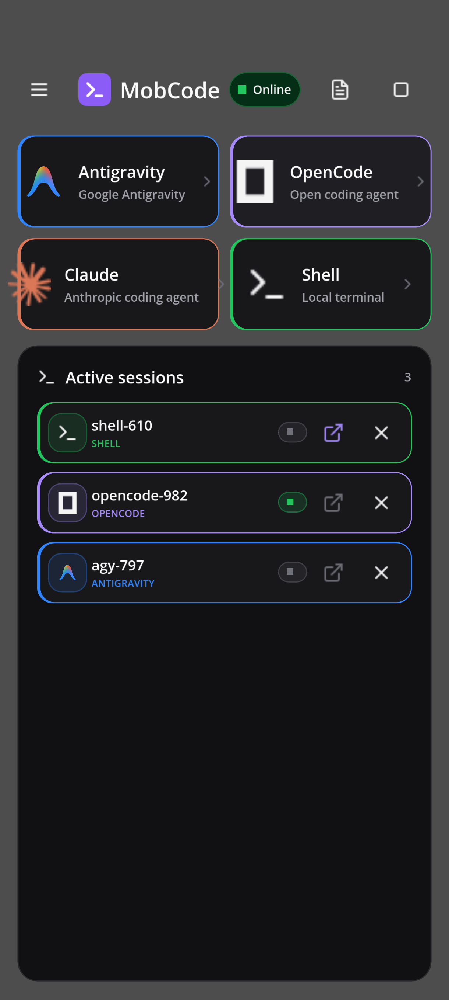

# MobCode ⚡
### Mobile AI Coding Command Center & Multi-Agent Terminal Hub for Android

<p align="center">
  
</p>

<p align="center">
  
  
  
  
  
</p>

---

## 🌟 Overview

**MobCode** is an open-source, mobile-first command center for developers running local AI coding agents directly on Android devices. Powered by **Godot Engine 4.x** for its reactive dashboard and backed by **Termux PTY multiprocessing** and a custom **native Android terminal engine**, MobCode allows you to launch, monitor, and interact with coding agents without constantly wrestling with raw terminal multiplexers.

Whether you are prompting **Google Antigravity (`agy`)**, orchestrating **OpenCode**, working with **Claude Code**, or running a standard **Linux Shell**, MobCode gives you a native mobile workflow with floating PIP indicators, gesture-friendly scrolling, and real-time state awareness.

---

## ✨ Features

- 🚀 **One-Tap Multi-Agent Launch:** Instantly launch and manage concurrent sessions for **Antigravity**, **OpenCode**, **Claude Code**, and **Local Shell**.
- 🖵 **Integrated Native Terminal:** Full ANSI/VT100 hardware-accelerated terminal canvas with 256-color support, DEC private modes, and full SGR mouse tracking (enabling smooth chat container scrolling in OpenCode without hijacking command history).
- ⌨️ **Termux ExtraKeys Toolbar:** Embedded two-row keyboard accessory toolbar (`ESC`, `TAB`, `CTRL`, `ALT`, `|`, `-`, arrows) aligned dynamically above the soft input keyboard.
- 🪐 **Draggable Floating Status Overlay:** Multi-session status pill rendered over external apps (`TYPE_APPLICATION_OVERLAY`), showing live agent badges (`⚡ CODE`, `🪐 AGY`, `✳ CLAUDE`, `❯_ SH`) and color-coded session states. Tapping the overlay instantly resumes MobCode to that active session.
- 🚦 **Intelligent Lifecycle & Approval Tracking:** PTY output streaming heuristics detect prompt returns, active tool loops, completions, and interactive approval requests (`[y/N]`, `Allow once`, `Permission required`), shifting states between:
  - 🟢 **Working / Running**
  - 🟡 **Needs Attention / Approval**
  - 🔵 **Completed / Idle**
  - 🟠 **Stopped / Exited**
  - 🔴 **Error / Crash**
- 🎙️ **Voice-to-Prompt:** Integrated speech recognizer enabling hands-free voice dictation straight into agent prompts.
- 🔋 **Background Wake-Lock Resilience:** Native Android Foreground Service (`SessionStatusService`) combined with `termux-wake-lock` prevents Android Doze mode and OS kills from killing your long-running builds and agent chains.
- 📁 **Unified Workspace:** Direct filesystem access to `/sdcard`, allowing live edits across mobile IDEs (Acode, DroidVim), Git, Termux, and PRoot Ubuntu.

---

## 🏗️ Architecture

```
┌────────────────────────────────────────────────────────┐
│                   MobCode (Godot 4.x)                  │
│  • Agent Dashboard  • Session Drawer  • Status Badges  │
└───────────────────────────┬────────────────────────────┘
                            │ JNI / Godot Plugin IPC
┌───────────────────────────▼────────────────────────────┐
│         Android Native Layer (MobCodeTerminal)         │
│  • TerminalManager       • TerminalView (Canvas PTY)   │
│  • ExtraKeysView         • FloatingStatusOverlay (PIP) │
│  • SessionStatusService  • SpeechRecognizer            │
└───────────────────────────┬────────────────────────────┘
                            │ TCP Localhost IPC (:8765)
┌───────────────────────────▼────────────────────────────┐
│          Termux Linux PTY Multiplexer Server           │
│           (backend/mobcode_pty_server.py)              │
├────────────────────────────────────────────────────────┤
│  • PTY Process Forking (openpty / TIOCSCTTY)           │
│  • Dynamic Window Resizing (SIGWINCH ioctl)            │
│  • Subprocess Stream Parsing & Status Heuristics       │
├───────────────────────────┬────────────────────────────┤
│                           │                            │
▼                           ▼                            ▼
[ Google Antigravity ]   [ OpenCode / Claude ]   [ Linux Bash Shell ]
(PRoot Ubuntu / Native)  (PRoot Ubuntu / Native) (PRoot / Termux /sdcard)
```

---

## 📋 Prerequisites

1. **Android Device:** Android 10 (API 29) or higher (arm64-v8a recommended).
2. **Termux:** Latest build from [F-Droid](https://f-droid.org/en/packages/com.termux/) or GitHub Releases.
3. **Termux:API** (optional, recommended for wake locks).
4. **PRoot Ubuntu** (optional):
   ```bash
   pkg install proot-distro
   proot-distro install ubuntu
   ```

---

## 🚀 Quick Setup & Installation

### 1. Configure Termux Permissions
MobCode communicates with Termux to manage background services and daemon processes:

```bash
# Allow external apps to send commands to Termux
mkdir -p ~/.termux
echo "allow-external-apps = true" >> ~/.termux/termux.properties

# Acquire wake-lock to prevent CPU sleep
termux-wake-lock

# Ensure storage permission is set
termux-setup-storage
```

### 2. Start the MobCode Background Daemon
In Termux, start the multiplexer daemon:
```bash
bash /sdcard/godot/mobcode/backend/mobcode_daemon.sh
```
*(The daemon automatically spawns the PTY multiplexer server on `127.0.0.1:8765` and watches session queues).*

### 3. Build & Install MobCode APK
From the project root:
```bash
# Build standard debug APK
cd android/build
./gradlew assembleStandardDebug

# Install via ADB
adb install -r build/outputs/apk/standard/debug/android-standard-debug.apk
```
*Or export directly via the Godot 4.x Android Export Preset.*

---

## 🎮 Usage Guide

1. **Launch a Session:** Tap any card on the dashboard (**Antigravity**, **OpenCode**, **Claude**, or **Shell**) to spawn an interactive session.
2. **Interact:**
   - Type commands or AI prompts using the soft keyboard.
   - Use the **ExtraKeys toolbar** (`ESC`, `TAB`, `CTRL`, `ALT`, arrows) for terminal navigation and readline shortcuts.
   - Tap **Mic** to dictate prompts via voice.
3. **Scroll OpenCode Chat:** Swipe up or down anywhere on the terminal canvas. MobCode automatically routes SGR mouse wheel escapes (`\033[<64...M`), scrolling the chat log without corrupting command line history.
4. **Floating Mode:** Tap the popout button on any active session card to enable its floating status badge. When you switch to another app, a draggable indicator stays on screen, displaying live color indicators (e.g. Amber for tool permission approval). Tap the badge at any time to return.

---

## 📂 Project Structure

```
mobcode/
├── android/build/               # Godot 4 Android custom build template
│   └── src/main/java/
│       ├── com/godot/game/      # Custom GodotActivity with PIP & insets handling
│       ├── com/mobcode/terminal/# MobCode terminal plugin, overlay, service
│       └── com/termux/          # Termux PTY canvas, emulator, and extra-keys
├── backend/                     # Termux backend scripts
│   ├── mobcode_daemon.sh        # Background daemon, status merger, and watcher
│   ├── mobcode_pty_server.py    # Multi-client TCP PTY server with state heuristics
│   └── mobcode_launcher.sh      # Intent command execution script
├── scenes/                      # Godot 4 UI scenes
│   ├── Main.tscn                # Primary application entrypoint
│   └── Dashboard.tscn           # Multi-agent grid & active session list
├── scripts/                     # GDScript business logic
│   ├── UI/                      # Dashboard UI controllers & Agent registry
│   └── Services/                # JNI plugin bridges & daemon poller
├── docs/                        # Project documentation & screenshots
│   └── mobcode_ui.png           # Dashboard UI showcase image
├── project.godot                # Godot 4 project definition
└── export_presets.cfg           # Android export presets
```

---

## 🛡️ License

This project is licensed under the [MIT License](LICENSE).
Termux terminal emulation components are derived from the open-source [Termux](https://github.com/termux/termux-app) project and licensed under GPLv3.
